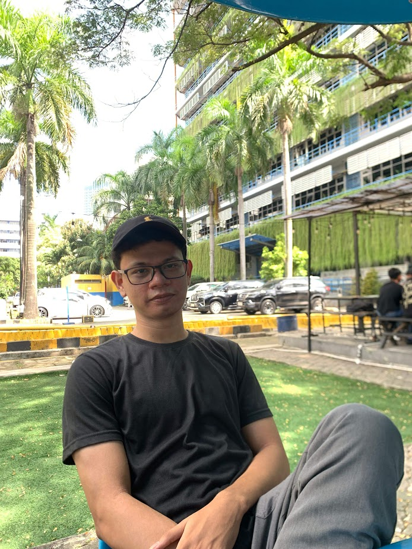
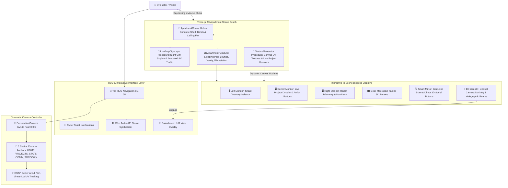

<p align="center">
  
</p>

<h1 align="center">⚡ FELIX PALINGAN // 3D CYBERPUNK PORTFOLIO</h1>

<p align="center">
  <strong>Immersive Cyberpunk 2077 Megabuilding H10 Apartment &amp; Netrunner Battlestation in Real-Time WebGL</strong><br />
  A high-performance creative developer portfolio proving technical depth and frontend craftsmanship through the 3D medium itself.
</p>

<p align="center">
  <a href="https://portfolio-felix-3bfd.vercel.app">
    
  </a>
  <a href="https://threejs.org/">
    
  </a>
  <a href="https://vite.dev/">
    
  </a>
  <a href="https://greensock.com/gsap/">
    
  </a>
  <a href="LICENSE">
    
  </a>
</p>

---

## 📖 Overview

Conventional developer portfolios rely on flat, static project cards that fail to showcase actual interactive engineering capabilities. This portfolio replaces generic grids with a **living, fully procedural 3D Netrunner apartment** inspired by V's Megabuilding H10 unit from *Cyberpunk 2077*.

Instead of navigating standard pages, every section transition physically choreographs the camera across the apartment in real-time WebGL space. Evaluators, recruiters, and engineering leaders explore real production projects directly rendered onto an in-scene **Triple-Monitor Battlestation**, inspect career memory shards through an authentic **Braindance (BD) Neural Wreath Visor**, and engage direct communication channels via a **Diegetic Smart Bathroom Mirror**.

🌐 **Production Deployment**: [https://portfolio-felix-3bfd.vercel.app](https://portfolio-felix-3bfd.vercel.app)

---

## 🏗️ System Architecture

The application is architected around a unified WebGL animation loop, combining Three.js scene graphs with real-time procedural canvas textures, GSAP cinematic camera choreography, and synthesized Web Audio soundscapes.



### Technology Stack & Engineering Rationale

| Layer | Technology | Engineering Rationale |
| :--- | :--- | :--- |
| **3D Rendering Engine** | **Three.js (r174)** | Industry-standard WebGL abstraction delivering low-level buffer geometry control, custom lighting models, and high-performance render loops. |
| **Build & Tooling** | **Vite 6** | Ultra-fast Hot Module Replacement (HMR), tree-shaking, and optimized production chunking. |
| **Animation Choreography** | **GSAP 3.12** | Smooth non-linear camera position and LookAt interpolations, easing curves, and UI micro-animations. |
| **Diegetic Textures** | **HTML5 Canvas 2D API** | Real-time procedural rendering of in-game computer screens, biometric mirror HUDs, and dynamic project dossiers without external image textures. |
| **Soundscape Engine** | **Web Audio API (`CyberAudio`)** | Zero-asset-dependency synthesized audio: UI clicks, Braindance engagement risers, cable unclamp clicks, and static glitch bursts. |
| **Hosting & CDN** | **Vercel Edge Network** | Sub-second global asset delivery, automated Git CI/CD deployments, and SPA route rewrites. |

---

## 🚀 Key Features & Capabilities

### 1. 🏢 Procedural 3D Megabuilding H10 Apartment
- **100% Procedural Geometry**: Entire apartment (sleeping pod, sunken lounge, open bathroom, wardrobe, workstation) is built from mathematical Three.js primitives—eliminating multi-megabyte GLTF downloads and guaranteeing sub-second load times.
- **Outside 3D Night City Skyline**: Features 16 diverse architectural skyscrapers, illuminated neon windows, flashing red aviation beacons, and animated autonomous flying vehicles (AVs) cruising across the sky.
- **Atmospheric Lighting**: Dedicated spotlight task lamps, ambient floor neon runners, and soft interior bounce lights creating authentic Cyberpunk chiaroscuro.

### 2. 🖥️ Netrunner Battlestation (Triple-Monitor Project Rig)
- **Diegetic UI (In-World Screen Rendering)**: Projects are rendered directly on virtual curved monitors inside the 3D world:
  - **Left Monitor**: Interactive Shard Selector displaying selectable project cards with live loadout badges.
  - **Center Monitor**: High-resolution Project Dossier featuring title, description, architecture highlights, tech tags, and clickable buttons for **Open GitHub Repository ↗** and **Run Live Demo ↗**.
  - **Right Monitor**: Live wireframe radar grid, simulated network telemetry, and navigation controls.
- **Dual Navigation**: Browse projects by clicking screen elements, clicking tactile 3D macropad buttons on the desk, or using keyboard arrows / scroll wheel.

### 3. 🥽 Braindance (BD) Neural Wreath Visor & Memory Archive
- **Faithful 3D Hardware Recreation**: Modeled after authentic Cyberpunk 2077 BD wreaths with a curved brow arch, temple housing blocks, illuminated blue neural crystals, dual cranial suction electrodes, and forward ocular projector arms.
- **Cinematic Camera Docking**: Engaging Braindance lowers the headset from the ceiling while the camera tracks it, docking the visor snugly to the player's first-person view.
- **Holographic Light Projection**: Optic diodes project dual volumetric light cones (`AdditiveBlending`) and a dynamic spotlight forward, projecting the memory archive HUD into the player's vision.
- **Scrubber Timeline**: Interactive timeline allowing visitors to scrub through career milestones and past engineering experiences.

### 4. 🪞 Diegetic Smart Bathroom Mirror & Comms Terminal
- **Biometric Identification**: Displays authentic operative biometric data, face targeting brackets, and retinal crosshairs over the author's portrait.
- **Tactile 3D Transmission Buttons**: Clickable 3D interface plates on the mirror face:
  - `✉ EMAIL COMMS`: One-click clipboard copy of email address with haptic visual feedback.
  - `◈ GITHUB ARCHIVE`: Direct link to [github.com/felixpalingan](https://github.com/felixpalingan).
  - `◆ LINKEDIN NET`: Direct link to LinkedIn profile.

---

## 📂 Project Directory Structure

```text
├── assets/                  # Public raw branding assets & photos
├── public/                  # Static assets served at root (icons, avatars)
│   ├── default.jpg          # Developer avatar image
│   ├── ironpixels_icon.png  # IronPixels project logo
│   └── oit_logo.png         # Oit project logo
├── src/
│   ├── data/
│   │   └── portfolioData.js # Centralized profile, stats, projects & experience data
│   ├── scene/
│   │   ├── ApartmentFurniture.js # Workstation, BD wreath, lounge, bathroom, lights
│   │   ├── ApartmentRoom.js      # Room walls, floors, ceiling, window opening
│   │   ├── BDPlaybackOverlay.js  # Diegetic 2D/AR Braindance HUD overlay
│   │   ├── CameraController.js   # 5-Anchor cinematic camera controller & lookAt tweening
│   │   ├── CyberAudio.js         # Web Audio API procedural sound synthesizer
│   │   ├── LowPolyCityscape.js   # 3D skyscrapers, warning beacons, flying AV traffic
│   │   └── TextureGenerator.js   # Procedural canvas textures (monitors, mirror, tiles)
│   ├── main.js              # Application entry, Three.js loop & raycasting interactions
│   └── style.css            # CRT scanlines, Cyberpunk HUD styles, Braindance visor HUD
├── index.html               # Main HTML entry point & loading screen
├── vercel.json              # Vercel deployment routing configuration
├── vite.config.js           # Vite build configuration
└── LICENSE                  # MIT License
```

---

## 💻 Local Development Setup

### Prerequisites
- [Node.js](https://nodejs.org/) (version 18.0.0 or higher recommended)
- `npm` or `pnpm` / `yarn`

### Installation Steps

1. **Clone the repository**:
   ```bash
   git clone https://github.com/felixpalingan/Portfolio.git
   cd Portfolio
   ```

2. **Install dependencies**:
   ```bash
   npm install
   ```

3. **Start the local development server**:
   ```bash
   npm run dev
   ```
   Open [http://localhost:3000](http://localhost:3000) in your browser.

4. **Build for production**:
   ```bash
   npm run build
   ```
   The production bundle will be generated in the `dist/` directory.

5. **Preview the production build**:
   ```bash
   npm run preview
   ```

---

## 📄 License

This project is open-source and released under the terms of the [MIT License](LICENSE).

---

## 👤 Author

**Felix Palingan (Almakius Felix Bariq Hekopung)**  
*Full Stack Web Developer & Creative Engineer*

- **Live Portfolio**: [https://portfolio-felix-3bfd.vercel.app](https://portfolio-felix-3bfd.vercel.app)
- **GitHub**: [@felixpalingan](https://github.com/felixpalingan)
- **LinkedIn**: [Almakius Felix Bariq Hekopung](https://www.linkedin.com/in/almakius-felix-bariq-hekopung/)
- **Email**: [felixbariq@gmail.com](mailto:felixbariq@gmail.com)

---

<p align="center">
  <sub>Megabuilding H10 // Watson District // Night City // Indonesia &copy; 2025-2026 Felix Palingan</sub>
</p>
